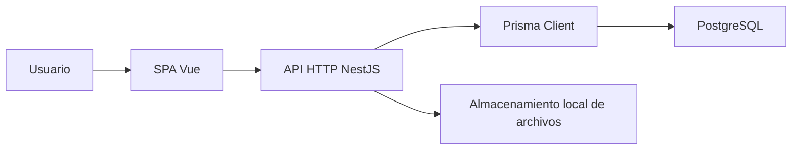

# Descripción general del sistema

El repositorio contiene una aplicación para gestionar la atención odontológica en un contexto docente. El recorrido visible enlaza el registro de pacientes, la preparación de casos por estudiantes, la revisión por profesores y el registro de intervenciones clínicas. La evidencia proviene del código en la revisión `cd52119` y de las comprobaciones del 21 de noviembre de 2026. Los documentos de `Resources/` aportan contexto de diseño. Una operación se considera existente cuando se encuentra su implementación efectiva.

## Arquitectura

- **Frontend.** `Frontendv2/src` contiene vistas por rol, componentes, servicios HTTP, almacenes Pinia, opciones de menú, composables y rutas Vue Router. Vue 3.5, TypeScript 5.9, Vite 7, Pinia 3 y Axios se declaran en el manifiesto. Axios usa `VITE_API_URL`, con valor predeterminado de desarrollo en el puerto 3000, y adjunta el JWT. [Manifiesto](../../Frontendv2/package.json), [cliente HTTP](../../Frontendv2/src/Config/api.ts), [rutas](../../Frontendv2/src/router/index.ts).
- **Backend.** `backendv2/src/modules` agrupa controladores, servicios y DTO, con guards y decoradores compartidos. NestJS 11 usa la plataforma Express. Passport local procesa credenciales y Passport JWT autentica peticiones. Bcrypt comprueba contraseñas, ExcelJS maneja hojas de cálculo, Multer recibe cargas y class-validator valida DTO. El arranque fija CORS a `http://localhost:5173`, escucha en el puerto 3000 y habilita transformación, lista blanca y rechazo de campos extra. [Manifiesto](../../backendv2/package.json), [arranque](../../backendv2/src/main.ts), [composición](../../backendv2/src/app.module.ts).
- **Persistencia.** Prisma Client 6 usa PostgreSQL por `DATABASE_URL`. Existen migraciones SQL versionadas y scripts de datos de referencia, tamizaje y preparación de administrador. La aplicación conecta Prisma e inicializa permisos y roles durante el arranque. [Modelo](../../backendv2/prisma/schema.prisma), [conexión](../../backendv2/prisma/prisma.service.ts), [inicialización](../../backendv2/src/modules/permisos/permisos-inicializador.service.ts), [migraciones](../../backendv2/prisma/migrations).
- **Integraciones.** Se observa PostgreSQL, archivos locales y entrada/salida Excel. Los controladores revisados no muestran integración operativa con servicios de correo, mensajería, almacenamiento remoto o sistemas sanitarios externos. [Servicio de archivos](../../backendv2/src/modules/Archivos/archivos.service.ts), [utilidad Excel](../../backendv2/src/common/utils/excel.ts), [módulos activos](../../backendv2/src/app.module.ts).

## Mapa de entidades

| Dominio | Entidades y relaciones |
| --- | --- |
| Identidad | Usuario tiene Role. RolePermiso y UsuarioPermiso enlazan con Permiso. UsuarioEspecialidad vincula usuarios y especialidades. |
| Geografía | País → Provincia → Cantón → Parroquia. Los formularios pueden referenciar parroquia. |
| Pacientes y casos | Paciente tiene casos y citas. CasoClinico vincula paciente, estudiante, profesor y especialidad. PreguntaClinica y RespuestaClinica estructuran el formulario. |
| Tamizaje | PreguntaTamizaje se relaciona con RespuestaTamizaje y EncuestaTamizaje, vinculada al paciente. |
| Atención | Odontograma y HallazgoClinico se vinculan al expediente. Tratamiento referencia CasoClinico y códigos de diagnóstico y procedimiento. Prescripcion se relaciona con CasoClinico. |
| Operación | Cita conecta paciente, especialidad, estudiante y docente opcional. Disponibilidad, Clinica, PersonalClinica y HorarioClinica aportan estructura de datos para posibles flujos. |
| Seguimiento | Observacion, Solicitud, Archivo, ArchivoRelacion y Log modelan comentarios, trámites, metadatos y auditoría. |

[Esquema de Prisma](../../backendv2/prisma/schema.prisma)

## Roles y alcance

Administrador gestiona usuarios y tiene acceso amplio a casos por API. Profesor gestiona estudiantes y revisa casos asignados. Estudiante abre y consulta los propios casos y registra intervenciones conforme a controles del servicio. Secretario aparece como rol, con operaciones aún por definir y acceso incidental en algunas rutas que solo exigen JWT. El cliente evalúa roles y menú. La API aplica JWT, RolesGuard, PermissionsGuard y comprobaciones de propiedad según el controlador. [Enumeración de roles](../../backendv2/src/common/enums/roles.enum.ts), [configuración del cliente](../../Frontendv2/src/Config/permissions.ts), [matriz de permisos](06_matriz_permisos.md).

## Índice

[Requisitos funcionales](02_requisitos_funcionales.md) · [Requisitos no funcionales](03_requisitos_no_funcionales.md) · [Reglas de negocio](04_reglas_de_negocio.md) · [Flujos](05_flujos_de_trabajo.md) · [Permisos](06_matriz_permisos.md) · [Estado de módulos](07_estado_de_modulos.md) · [Pendientes](08_pendientes_y_mejoras.md) · [Plan](09_plan_de_trabajo.md) · [Pruebas](10_pruebas_y_calidad.md)
