# Flujos de trabajo

Los flujos actuales documentan el alcance observado. Las propuestas requieren las decisiones de la [lista de pendientes](08_pendientes_y_mejoras.md).

## Autenticación y sesión

- **Objetivo.** Iniciar sesión con credenciales. Cerrar sesión local. Restaurar sesión y procesar expiración.
- **Actores y condición previa.** Todos con cuenta activa. Usuario activo envía correo y contraseña.
- **Validaciones y estados.** El inicio requiere usuario activo y contraseña válida; JwtStrategy vuelve a comprobar actividad.
- **Datos, resultado y excepciones.** Pinia y Axios usan Bearer; 401 limpia sesión. Sesión expirada o cuenta inactiva produce rechazo; la salida elimina datos locales.
- **Trabajo pendiente.** Definir renovación, revocación y control de intentos; probar baja durante una sesión.
- **Evidencia.** [auth.controller.ts](../../backendv2/src/modules/auth/auth.controller.ts), [auth.service.ts](../../backendv2/src/modules/auth/auth.service.ts), [LoginView.vue](../../Frontendv2/src/views/LoginView.vue), [auth.ts](../../Frontendv2/src/stores/auth.ts), [api.ts](../../Frontendv2/src/Config/api.ts).

### Actual

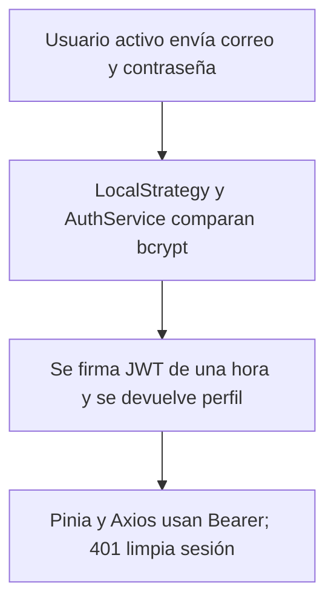

### Propuesto

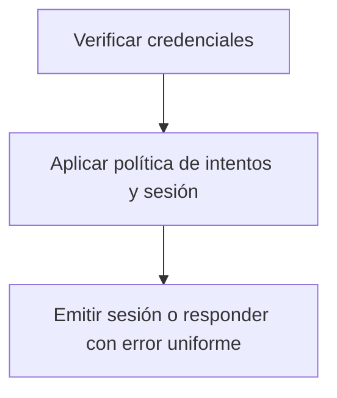

## Usuarios y perfil

- **Objetivo.** Crear y consultar usuarios. Buscar y filtrar usuarios. Editar perfil propio. Cambiar contraseña propia. Activar y desactivar usuarios. Eliminar usuarios. Importar usuarios o estudiantes con Excel. Descargar plantilla Excel. Exportar usuarios. Consultar estadísticas de usuarios.
- **Actores y condición previa.** Administrador, profesor y estudiante según operación. Usuario autenticado abre gestión o perfil.
- **Validaciones y estados.** El profesor solo registra y lista estudiantes; editar perfil propio no permite cambiar rol, activo ni especialidades; cambio de clave exige clave actual y confirmación.
- **Datos, resultado y excepciones.** La vista actualiza datos o presenta error. Conflicto de correo/documento; errores de filas o referencias; restricción por rol.
- **Trabajo pendiente.** Verificar alcance docente y resultados parciales de Excel con relaciones reales.
- **Evidencia.** [usuarios.controller.ts](../../backendv2/src/modules/usuarios/usuarios.controller.ts), [usuarios.service.ts](../../backendv2/src/modules/usuarios/usuarios.service.ts), [UsuariosView.vue](../../Frontendv2/src/views/Admin/UsuariosView.vue), [EstudiantesView.vue](../../Frontendv2/src/views/Profesor/EstudiantesView.vue), [Perfil.vue](../../Frontendv2/src/views/Perfil.vue).

### Actual

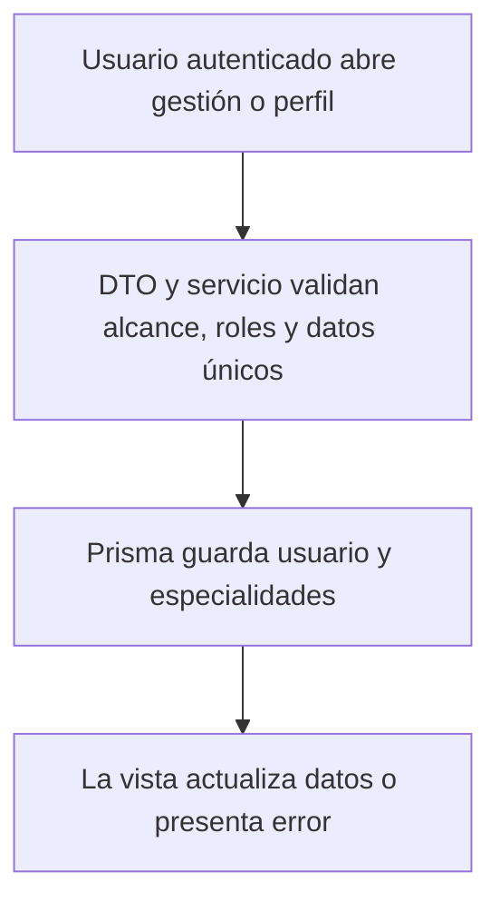

### Propuesto

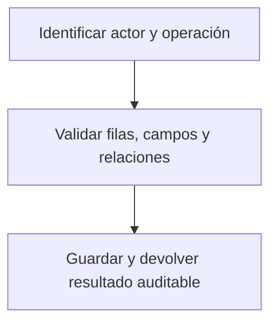

## Roles

- **Objetivo.** Listar roles. Crear rol. Editar o eliminar rol. Asignar permisos al rol.
- **Actores y condición previa.** Público para catálogo; gestor previsto. Cliente consulta catálogo o solicita gestión.
- **Validaciones y estados.** El servicio verifica unicidad y existencia de permisos; la asignación usa transacción.
- **Datos, resultado y excepciones.** Las rutas con permiso necesitan un usuario autenticado que el controlador no carga. JWT comentado a nivel de controlador; solo listado básico tiene ruta sin metadatos de permiso.
- **Trabajo pendiente.** Restablecer cadena JWT y permisos y conectar administración cuando se apruebe.
- **Evidencia.** [roles.controller.ts](../../backendv2/src/modules/roles/roles.controller.ts), [roles.service.ts](../../backendv2/src/modules/roles/roles.service.ts).

### Actual

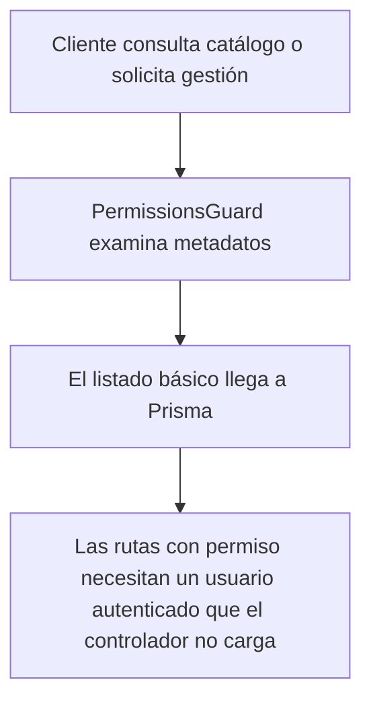

### Propuesto

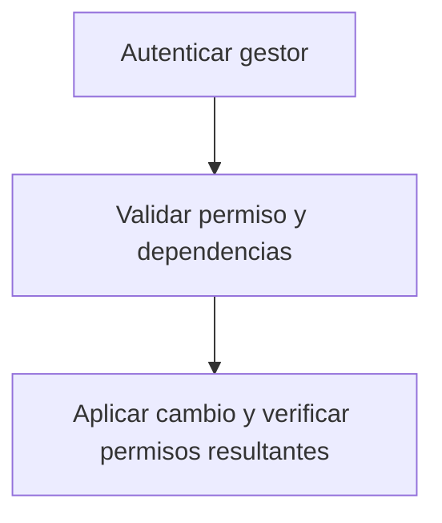

## Permisos

- **Objetivo.** Consultar catálogo, módulos y agrupación de permisos. Evaluar permisos por rol e individuales.
- **Actores y condición previa.** Cuenta autenticada con permiso requerido. Inicio del módulo inicializa catálogo.
- **Validaciones y estados.** Los permisos individuales expirados o inactivos se excluyen; el guard admite cualquiera de los permisos requeridos.
- **Datos, resultado y excepciones.** La API lista permisos según metadatos; menú usa mapa local. El mapa del cliente y la autorización del servidor no son equivalentes.
- **Trabajo pendiente.** Definir gestión de permisos individuales y alinear menú, rutas y API.
- **Evidencia.** [permisos.controller.ts](../../backendv2/src/modules/permisos/permisos.controller.ts), [permisos.service.ts](../../backendv2/src/modules/permisos/permisos.service.ts), [permissions.ts](../../Frontendv2/src/Config/permissions.ts), [usePermissions.ts](../../Frontendv2/src/composables/usePermissions.ts).

### Actual

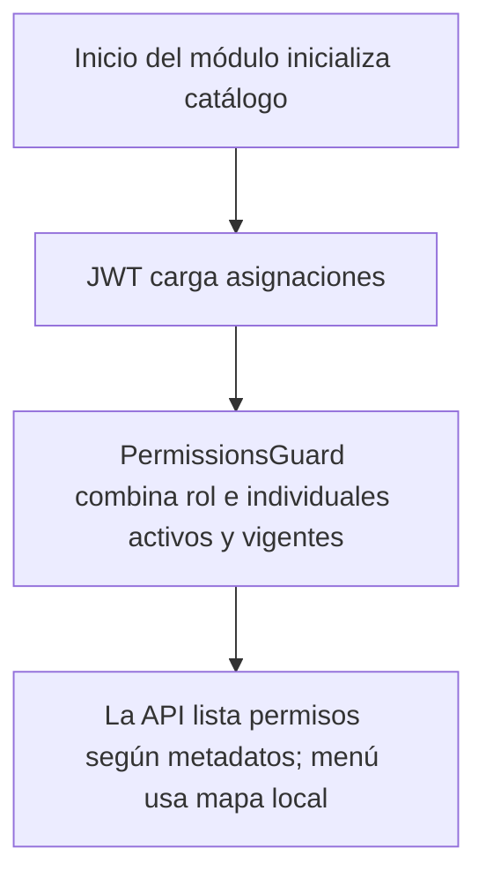

### Propuesto

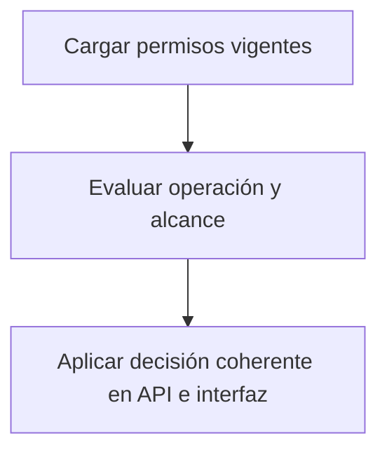

## Pacientes

- **Objetivo.** Registrar paciente. Buscar, paginar y consultar paciente. Consultar historial completo. Editar paciente. Desactivar y reactivar paciente.
- **Actores y condición previa.** Administrador, profesor y estudiante; edición y actividad por administrador. Actor autorizado selecciona o registra paciente.
- **Validaciones y estados.** Correo y documento se comprueban antes de guardar; modificación y cambios de actividad reservados al administrador.
- **Datos, resultado y excepciones.** Administrador puede cambiar estado activo. Conflicto de identificación, paciente ausente o parroquia inválida; alcance de historial requiere validación clínica.
- **Trabajo pendiente.** Acordar alcance por vínculo clínico y comprobar datos que se devuelven por rol.
- **Evidencia.** [pacientes.controller.ts](../../backendv2/src/modules/Pacientes/pacientes.controller.ts), [pacientes.service.ts](../../backendv2/src/modules/Pacientes/pacientes.service.ts), [PacientesView.vue](../../Frontendv2/src/views/Estudiantes/PacientesView.vue), [PacienteModal.vue](../../Frontendv2/src/components/estudiantes/PacienteModal.vue), [HistorialCompletoModal.vue](../../Frontendv2/src/components/estudiantes/pacientes/HistorialCompletoModal.vue).

### Actual

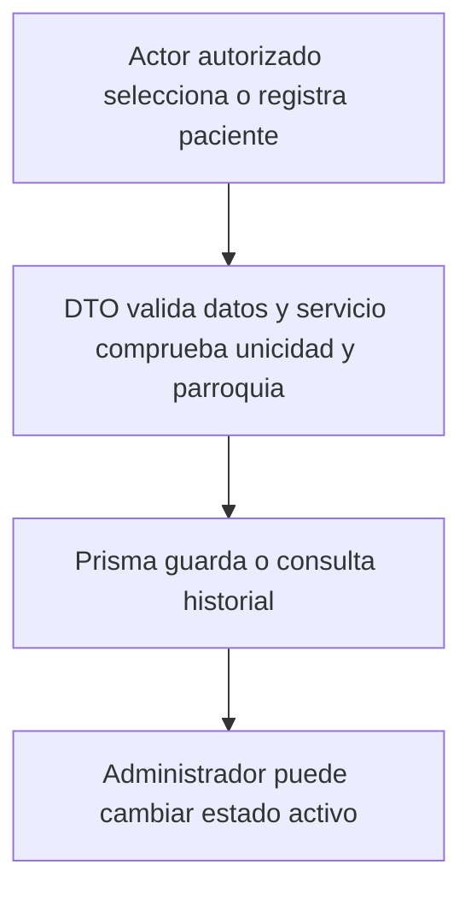

### Propuesto

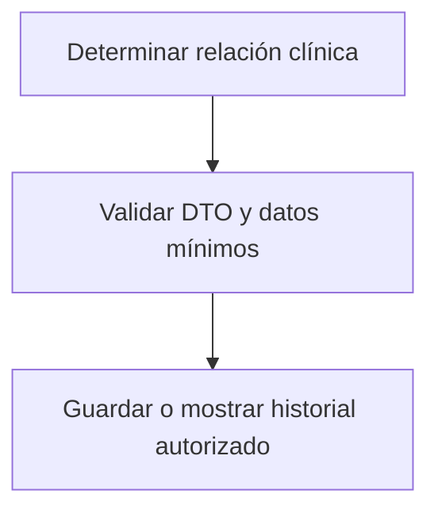

## País

- **Objetivo.** Listar países. Registrar país.
- **Actores y condición previa.** API pública en código. Cliente solicita catálogo o alta.
- **Validaciones y estados.** País es padre de provincia en el esquema.
- **Datos, resultado y excepciones.** Catálogo sirve como padre de provincias. API sin guard; gestión en interfaz sin evidencia.
- **Trabajo pendiente.** Proteger mutaciones y confirmar responsable de catálogo.
- **Evidencia.** [pais.controller.ts](../../backendv2/src/modules/Pais/pais.controller.ts), [pais.service.ts](../../backendv2/src/modules/Pais/pais.service.ts).

### Actual

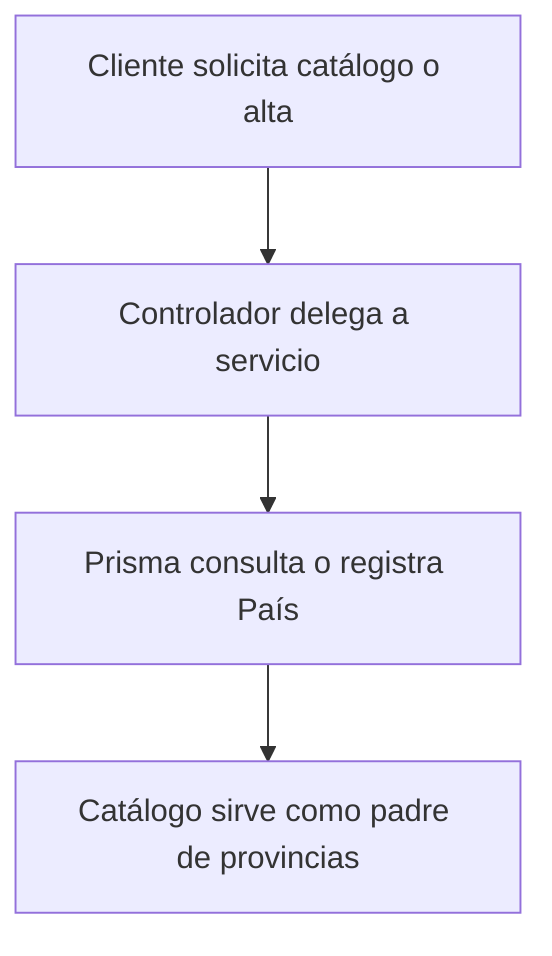

### Propuesto

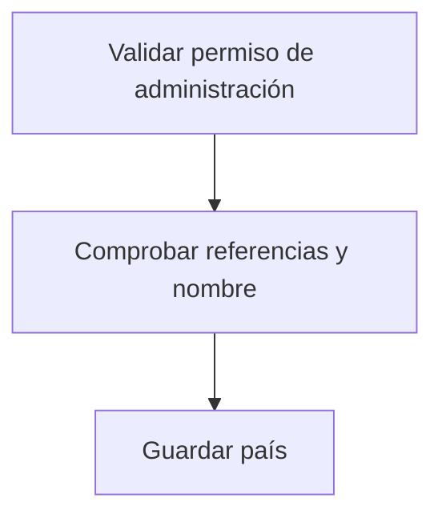

## Provincia

- **Objetivo.** Listar provincias. Crear o eliminar provincia.
- **Actores y condición previa.** API pública en código. Cliente lista, crea o elimina.
- **Validaciones y estados.** Provincia pertenece a un país según el esquema.
- **Datos, resultado y excepciones.** Resultado depende de integridad referencial. API sin guard; verificar borrado con cantones dependientes.
- **Trabajo pendiente.** Definir gestión de catálogo y comprobar errores por dependencias.
- **Evidencia.** [provincia.controller.ts](../../backendv2/src/modules/Provincia/provincia.controller.ts), [provincia.service.ts](../../backendv2/src/modules/Provincia/provincia.service.ts).

### Actual

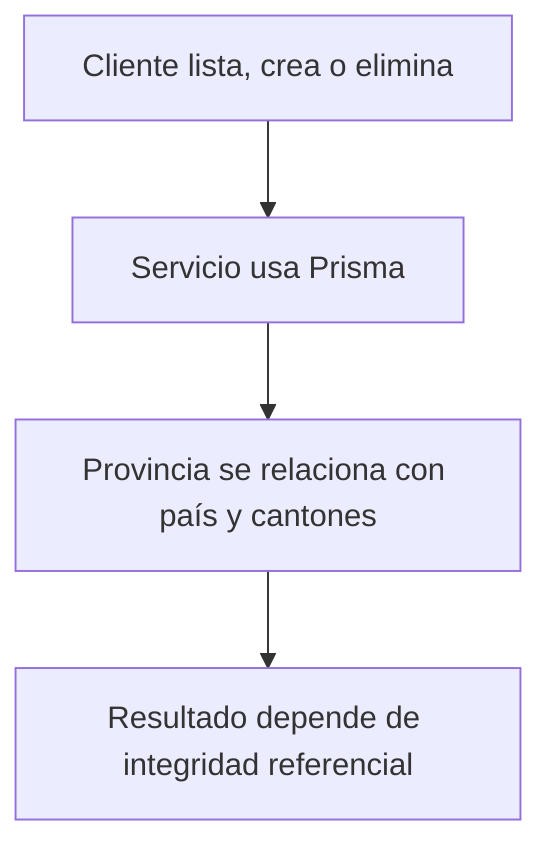

### Propuesto

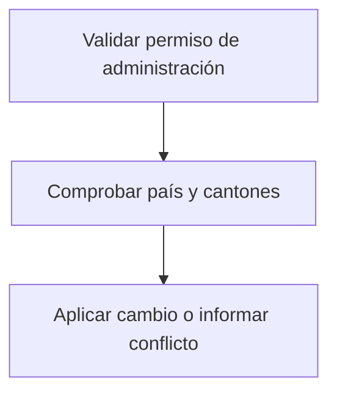

## Cantón

- **Objetivo.** Listar cantones. Crear o eliminar cantón.
- **Actores y condición previa.** API pública en código. Cliente lista, crea o elimina.
- **Validaciones y estados.** Cantón pertenece a una provincia según el esquema.
- **Datos, resultado y excepciones.** Se devuelve resultado de persistencia. API sin guard; comprobar efecto de dependencias antes de habilitar gestión.
- **Trabajo pendiente.** Proteger mutaciones y definir política de bajas.
- **Evidencia.** [canton.controller.ts](../../backendv2/src/modules/Canton/canton.controller.ts), [canton.service.ts](../../backendv2/src/modules/Canton/canton.service.ts).

### Actual

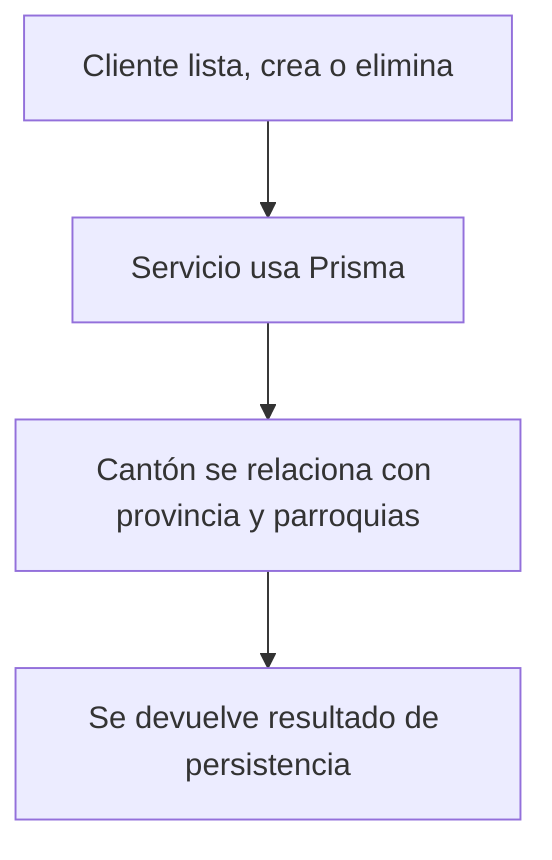

### Propuesto

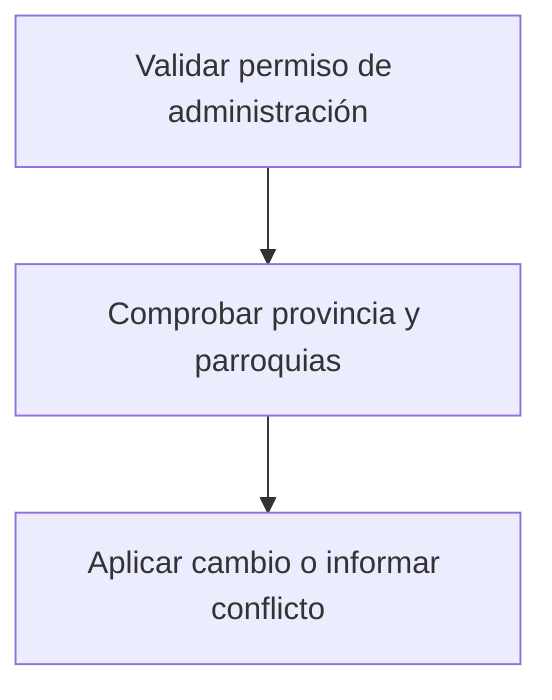

## Parroquia

- **Objetivo.** Buscar y listar parroquias. Crear o eliminar parroquia.
- **Actores y condición previa.** API pública; búsqueda desde formularios. Formulario busca ubicación.
- **Validaciones y estados.** Parroquia pertenece a un cantón; pacientes y usuarios pueden referenciarla.
- **Datos, resultado y excepciones.** Alta de paciente o usuario conserva su ID. Búsqueda integrada; mutaciones públicas y sin pantalla de catálogo localizada.
- **Trabajo pendiente.** Proteger escrituras y verificar búsqueda con datos de referencia.
- **Evidencia.** [parroquia.controller.ts](../../backendv2/src/modules/Parroquia/parroquia.controller.ts), [parroquia.service.ts](../../backendv2/src/modules/Parroquia/parroquia.service.ts), [useParroquiasSearch.ts](../../Frontendv2/src/composables/useParroquiasSearch.ts), [parroquias.service.ts](../../Frontendv2/src/services/estudiantes/Pacientes/parroquias.service.ts).

### Actual

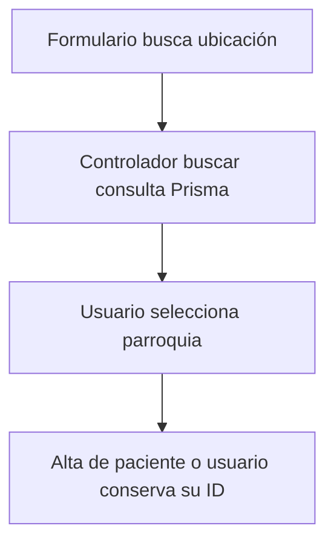

### Propuesto

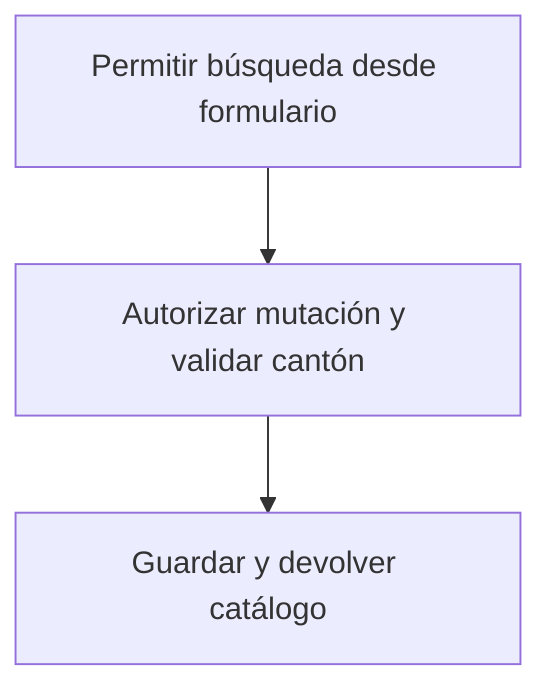

## Especialidades

- **Objetivo.** Crear, consultar y listar especialidades. Editar y eliminar especialidades. Consultar profesores por especialidad desde selección clínica.
- **Actores y condición previa.** Administrador en UI; cuenta JWT en API de catálogo. Administración abre catálogo.
- **Validaciones y estados.** La asignación UsuarioEspecialidad se usa para validar el docente del caso.
- **Datos, resultado y excepciones.** Selección clínica consume catálogo y asignaciones. La ruta visual es administrativa y el controlador de catálogo solo exige JWT.
- **Trabajo pendiente.** Separar consulta clínica de gestión y probar efectos sobre referencias.
- **Evidencia.** [especialidades.controller.ts](../../backendv2/src/modules/especialidades/especialidades.controller.ts), [especialidades.service.ts](../../backendv2/src/modules/especialidades/especialidades.service.ts), [EspecialidadesView.vue](../../Frontendv2/src/views/Admin/EspecialidadesView.vue), [useProfesoresEspecialidades.ts](../../Frontendv2/src/composables/useProfesoresEspecialidades.ts).

### Actual

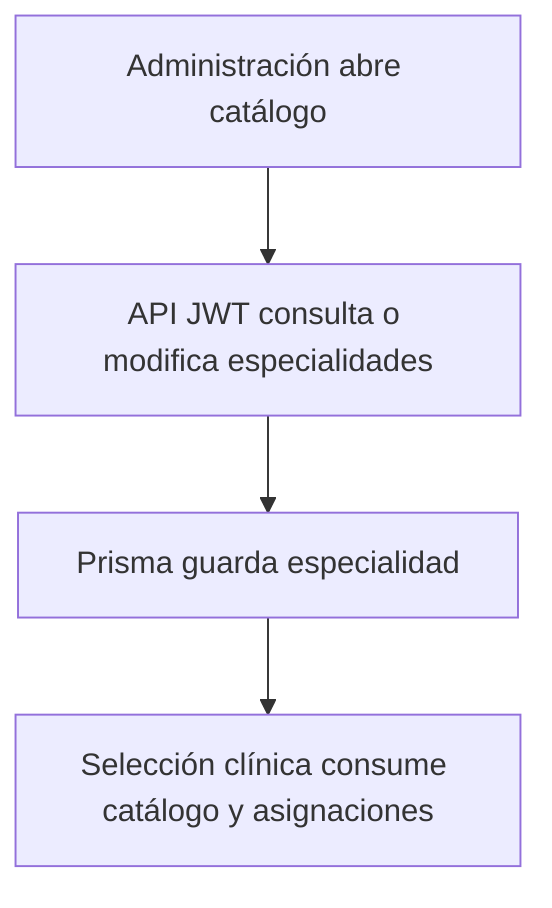

### Propuesto

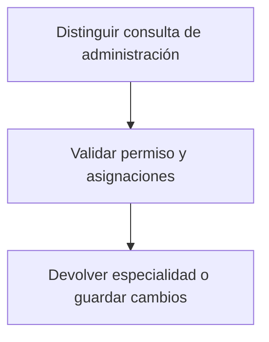

## Casos clínicos

- **Objetivo.** Crear caso y guardar respuestas. Consultar casos por paciente, estudiante o profesor. Revisar caso asignado y registrar calificación. Finalizar caso propio.
- **Actores y condición previa.** Administrador, profesor asignado y estudiante propietario. Estudiante selecciona paciente, especialidad y profesor.
- **Validaciones y estados.** Profesor asignado aprueba o rechaza desde EN_REVISION; estudiante finaliza desde APROBADO o EN_TRATAMIENTO con al menos un tratamiento y sin asignar nota.
- **Datos, resultado y excepciones.** Estudiante finaliza caso propio elegible con tratamiento. Un paso clínico puede mover EN_REVISION a EN_TRATAMIENTO antes de la revisión; revisar concurrencia y política de reapertura.
- **Trabajo pendiente.** Acordar transiciones y reutilizarlas desde los módulos que alteran el caso.
- **Evidencia.** [casos-clinicos.controller.ts](../../backendv2/src/modules/CasosClinicos/casos-clinicos.controller.ts), [casos-clinicos.service.ts](../../backendv2/src/modules/CasosClinicos/casos-clinicos.service.ts), [CasoClinico.vue](../../Frontendv2/src/views/Estudiantes/CasoClinico.vue), [CasosPendientesView.vue](../../Frontendv2/src/views/Profesor/CasosPendientesView.vue), [TratamientosPrescripcionesView.vue](../../Frontendv2/src/views/Estudiantes/TratamientosPrescripcionesView.vue).

### Actual

```mermaid
flowchart TD
    N0["Estudiante selecciona paciente, especialidad y profesor"]
    N1["Servicio verifica relaciones y asignación docente"]
    N0 --> N1
    N2["Transacción guarda caso y respuestas"]
    N1 --> N2
    N3["Profesor revisa su caso en revisión"]
    N2 --> N3
    N4["Estudiante finaliza caso propio elegible con tratamiento"]
    N3 --> N4
```

### Propuesto

```mermaid
flowchart TD
    N0["Crear caso y respuestas"]
    N1["Revisar por docente asignado"]
    N0 --> N1
    N2["Habilitar operaciones según estado acordado"]
    N1 --> N2
    N3["Finalizar con tratamiento y registrar transición"]
    N2 --> N3
```

## Preguntas clínicas

- **Objetivo.** Crear pregunta clínica. Filtrar y consultar preguntas. Editar y eliminar pregunta. Responder formulario clínico.
- **Actores y condición previa.** Profesor y administrador en UI; JWT en API; estudiante responde. Profesor abre configuración y selecciona especialidad.
- **Validaciones y estados.** Una especialidad indicada debe existir; respuestas persisten asociadas a caso y pregunta.
- **Datos, resultado y excepciones.** Caso registra respuestas. La escritura del catálogo solo exige JWT; impacto en respuestas históricas por validar.
- **Trabajo pendiente.** Restringir edición y definir versionado o baja sin pérdida histórica.
- **Evidencia.** [preguntas-clinicas.controller.ts](../../backendv2/src/modules/PreguntasClinicas/preguntas-clinicas.controller.ts), [preguntas-clinicas.service.ts](../../backendv2/src/modules/PreguntasClinicas/preguntas-clinicas.service.ts), [PreguntasClinicasView.vue](../../Frontendv2/src/views/Profesor/PreguntasClinicasView.vue), [PreguntasDinamicas.vue](../../Frontendv2/src/components/estudiantes/PreguntasDinamicas.vue).

### Actual

```mermaid
flowchart TD
    N0["Profesor abre configuración y selecciona especialidad"]
    N1["Servicio valida especialidad y persiste pregunta"]
    N0 --> N1
    N2["Formulario del caso renderiza preguntas"]
    N1 --> N2
    N3["Caso registra respuestas"]
    N2 --> N3
```

### Propuesto

```mermaid
flowchart TD
    N0["Autorizar gestión del cuestionario"]
    N1["Validar especialidad y uso histórico"]
    N0 --> N1
    N2["Publicar preguntas para formularios activos"]
    N1 --> N2
```

## Encuesta de tamizaje

- **Objetivo.** Consultar preguntas y categorías. Guardar respuestas y ver progreso. Consultar encuesta e historial. Crear nueva versión. Consultar estadísticas y gestionar altas/bajas de preguntas.
- **Actores y condición previa.** Cuenta JWT; catálogo de preguntas público. Actor selecciona paciente.
- **Validaciones y estados.** Una encuesta indicada debe pertenecer al paciente; guardado agrupa respuestas en transacción.
- **Datos, resultado y excepciones.** Cliente vuelve a consultar progreso o historial. Rutas de paciente y administración solo exigen JWT; baja expuesta como GET; actualizarPregunta sin ruta conectada.
- **Trabajo pendiente.** Restringir acceso por paciente y rol; completar contrato de administración y probar versionado concurrente.
- **Evidencia.** [encuesta-tamizaje.controller.ts](../../backendv2/src/modules/EncuestaTamizaje/encuesta-tamizaje.controller.ts), [encuesta-tamizaje.service.ts](../../backendv2/src/modules/EncuestaTamizaje/encuesta-tamizaje.service.ts), [EncuestaTamizajeModal.vue](../../Frontendv2/src/components/estudiantes/EncuestaTamizaje/EncuestaTamizajeModal.vue), [encuestaTamizaje.ts](../../Frontendv2/src/stores/Estudiantes/encuestaTamizaje.ts).

### Actual

```mermaid
flowchart TD
    N0["Actor selecciona paciente"]
    N1["Cliente carga preguntas, progreso y versión"]
    N0 --> N1
    N2["Servicio verifica paciente y pertenencia de encuesta"]
    N1 --> N2
    N3["Transacción guarda respuestas"]
    N2 --> N3
    N4["Cliente vuelve a consultar progreso o historial"]
    N3 --> N4
```

### Propuesto

```mermaid
flowchart TD
    N0["Autorizar acceso al paciente"]
    N1["Resolver versión y preguntas vigentes"]
    N0 --> N1
    N2["Guardar respuestas y mostrar historial permitido"]
    N1 --> N2
```

## Citas y agenda

- **Objetivo.** Reservar cita. Listar y consultar citas. Editar o reprogramar cita. Cancelar cita.
- **Actores y condición previa.** ADMIN, PROFESOR y ESTUDIANTE en UI; cuenta JWT en API. Actor elige paciente y horario.
- **Validaciones y estados.** Paciente, especialidad y usuarios indicados deben existir; hora final posterior a la inicial en creación.
- **Datos, resultado y excepciones.** Cancelación cambia estado a CANCELADA. Edición parcial no siempre contrasta ambos extremos; sin control de vínculo, disponibilidad o solapamiento.
- **Trabajo pendiente.** Validar fecha y ventana resultantes, roles, concurrencia y zona horaria.
- **Evidencia.** [citas.controller.ts](../../backendv2/src/modules/Citas/citas.controller.ts), [citas.service.ts](../../backendv2/src/modules/Citas/citas.service.ts), [Agenda.vue](../../Frontendv2/src/views/Estudiantes/Agenda.vue), [CitasModal.vue](../../Frontendv2/src/components/estudiantes/pacientes/CitasModal.vue).

### Actual

```mermaid
flowchart TD
    N0["Actor elige paciente y horario"]
    N1["API comprueba referencias y orden de horas al alta"]
    N0 --> N1
    N2["Cita nace RESERVADA"]
    N1 --> N2
    N3["Agenda consulta, edita o cancela"]
    N2 --> N3
    N4["Cancelación cambia estado a CANCELADA"]
    N3 --> N4
```

### Propuesto

```mermaid
flowchart TD
    N0["Autorizar actor y participantes"]
    N1["Validar intervalo y disponibilidad"]
    N0 --> N1
    N2["Reservar o solicitar otro horario"]
    N1 --> N2
```

## Disponibilidad

- **Objetivo.** Consultar o registrar disponibilidad para evaluar una reserva.
- **Actores y condición previa.** Por definir. El esquema define Disponibilidad.
- **Validaciones y estados.** La existencia del modelo requiere definición de responsables y uso en agenda.
- **Datos, resultado y excepciones.** No se encontró captura operativa ni consulta desde CitasService. Reservar no consulta disponibilidad.
- **Trabajo pendiente.** Confirmar horarios, excepciones y unidad de reserva antes de integrar.
- **Evidencia.** [Modelo Prisma](../../backendv2/prisma/schema.prisma#L417).

### Actual

```mermaid
flowchart TD
    N0["El esquema define Disponibilidad"]
    N1["No se encontró captura operativa ni consulta desde CitasService"]
    N0 --> N1
```

### Propuesto

```mermaid
flowchart TD
    N0["Aprobar responsables y alcance"]
    N1["Registrar horarios y excepciones"]
    N0 --> N1
    N2["Consultar intervalos en agenda"]
    N1 --> N2
```

## Odontograma

- **Objetivo.** Registrar datos dentales y nota general. Consultar odontograma por caso.
- **Actores y condición previa.** Estudiante en flujo de caso; JWT en API. Actor abre caso y edita caras u observación.
- **Validaciones y estados.** Debe existir al menos una cara dental o una observación general.
- **Datos, resultado y excepciones.** Consulta reconstruye odontograma del caso. Existencia de caso y usuarios no equivale a comprobar vínculo con actor.
- **Trabajo pendiente.** Aplicar autorización por caso y probar reenvíos, edición y reconstrucción.
- **Evidencia.** [odontograma.controller.ts](../../backendv2/src/modules/Odontograma/odontograma.controller.ts), [odontograma.service.ts](../../backendv2/src/modules/Odontograma/odontograma.service.ts), [OdontogramaEditor.vue](../../Frontendv2/src/components/estudiantes/Odontograma/OdontogramaEditor.vue), [CasoClinico.vue](../../Frontendv2/src/views/Estudiantes/CasoClinico.vue).

### Actual

```mermaid
flowchart TD
    N0["Actor abre caso y edita caras u observación"]
    N1["Servicio confirma caso y usuarios"]
    N0 --> N1
    N2["Transacción guarda datos dentales y observación"]
    N1 --> N2
    N3["Consulta reconstruye odontograma del caso"]
    N2 --> N3
```

### Propuesto

```mermaid
flowchart TD
    N0["Autorizar acceso al caso"]
    N1["Validar pieza, cara y contenido"]
    N0 --> N1
    N2["Guardar o recuperar datos dentales"]
    N1 --> N2
```

## Hallazgos clínicos

- **Objetivo.** Registrar y consultar hallazgo clínico estructurado.
- **Actores y condición previa.** Por definir. Prisma define HallazgoClinico.
- **Validaciones y estados.** El modelo permite relación con odontograma y archivo; flujo clínico por confirmar.
- **Datos, resultado y excepciones.** No se encontró registro o revisión clínica del hallazgo. Uso auxiliar de borrado de archivo; no hay captura de hallazgo localizada.
- **Trabajo pendiente.** Validar necesidad de flujo independiente frente al odontograma.
- **Evidencia.** [Modelo Prisma](../../backendv2/prisma/schema.prisma#L288).

### Actual

```mermaid
flowchart TD
    N0["Prisma define HallazgoClinico"]
    N1["El borrado de archivos desvincula referencias"]
    N0 --> N1
    N2["No se encontró registro o revisión clínica del hallazgo"]
    N1 --> N2
```

### Propuesto

```mermaid
flowchart TD
    N0["Confirmar alcance independiente"]
    N1["Validar vínculo y datos de hallazgo"]
    N0 --> N1
    N2["Guardar y revisar"]
    N1 --> N2
```

## Diagnóstico clínico

- **Objetivo.** Registrar tipo y código diagnóstico en tratamiento. Consultar diagnóstico con tratamiento.
- **Actores y condición previa.** Estudiante propietario. Estudiante abre tratamiento del caso.
- **Validaciones y estados.** El tratamiento admite tipo presuntivo o definitivo según esquema y permite códigos opcionales.
- **Datos, resultado y excepciones.** Tratamiento conserva diagnóstico y procedimiento. Validación del código por existencia; confirmar categorías y si se requiere diagnóstico previo independiente.
- **Trabajo pendiente.** Acordar obligatoriedad, tipo de código y supervisión del diagnóstico.
- **Evidencia.** [Modelo Prisma](../../backendv2/prisma/schema.prisma#L217), [TratamientosPrescripcionesView.vue](../../Frontendv2/src/views/Estudiantes/TratamientosPrescripcionesView.vue), [TratamientoCasoModal.vue](../../Frontendv2/src/components/estudiantes/tratamientos/TratamientoCasoModal.vue).

### Actual

```mermaid
flowchart TD
    N0["Estudiante abre tratamiento del caso"]
    N1["Selecciona tipo y códigos disponibles"]
    N0 --> N1
    N2["TratamientosService verifica existencia de códigos"]
    N1 --> N2
    N3["Tratamiento conserva diagnóstico y procedimiento"]
    N2 --> N3
```

### Propuesto

```mermaid
flowchart TD
    N0["Confirmar obligatoriedad y tipo"]
    N1["Validar categoría del código"]
    N0 --> N1
    N2["Persistir diagnóstico autorizado"]
    N1 --> N2
```

## Catálogo CIE-10 y procedimientos

- **Objetivo.** Consultar y filtrar códigos. Crear, editar o eliminar códigos. Descargar plantilla e importar Excel.
- **Actores y condición previa.** Administrador en UI; cuenta JWT en API. Administrador abre catálogo.
- **Validaciones y estados.** El código identifica el registro y participa como referencia desde tratamiento.
- **Datos, resultado y excepciones.** El formulario clínico consume códigos. Mutaciones solo protegidas por JWT; probar importaciones y baja con códigos en uso.
- **Trabajo pendiente.** Limitar escritura, probar colisiones y acordar política para códigos referenciados.
- **Evidencia.** [cie10.controller.ts](../../backendv2/src/modules/CIE10/cie10.controller.ts), [cie10.service.ts](../../backendv2/src/modules/CIE10/cie10.service.ts), [Cie10View.vue](../../Frontendv2/src/views/Admin/Cie10View.vue), [cie10.service.ts](../../Frontendv2/src/services/Admin/cie10.service.ts).

### Actual

```mermaid
flowchart TD
    N0["Administrador abre catálogo"]
    N1["API filtra o recibe formulario/Excel"]
    N0 --> N1
    N2["Servicio normaliza códigos y consulta/escribe Prisma"]
    N1 --> N2
    N3["El formulario clínico consume códigos"]
    N2 --> N3
```

### Propuesto

```mermaid
flowchart TD
    N0["Autorizar escritura del catálogo"]
    N1["Normalizar y validar códigos"]
    N0 --> N1
    N2["Proteger referencias y devolver resultado"]
    N1 --> N2
```

## Tratamientos

- **Objetivo.** Consultar tratamientos del caso. Registrar tratamiento y signos vitales. Registrar receta opcional en la misma operación.
- **Actores y condición previa.** Estudiante propietario. Propietario abre caso.
- **Validaciones y estados.** Solo el estudiante vinculado opera; el alta se bloquea si el caso está cancelado.
- **Datos, resultado y excepciones.** Puede mover el caso a EN_TRATAMIENTO. Sin endpoints de seguimiento del tratamiento; la UI administrativa no confiere acceso ajeno; normalización de códigos difiere entre validación y escritura.
- **Trabajo pendiente.** Alinear alta con revisión clínica, normalizar una sola vez y definir seguimiento.
- **Evidencia.** [tratamientos.controller.ts](../../backendv2/src/modules/Tratamientos/tratamientos.controller.ts), [tratamientos.service.ts](../../backendv2/src/modules/Tratamientos/tratamientos.service.ts), [TratamientosPrescripcionesView.vue](../../Frontendv2/src/views/Estudiantes/TratamientosPrescripcionesView.vue), [TratamientoCasoModal.vue](../../Frontendv2/src/components/estudiantes/tratamientos/TratamientoCasoModal.vue).

### Actual

```mermaid
flowchart TD
    N0["Propietario abre caso"]
    N1["Servicio valida vínculo, que no esté cancelado y códigos"]
    N0 --> N1
    N2["Transacción guarda tratamiento PENDIENTE y receta opcional"]
    N1 --> N2
    N3["Puede mover el caso a EN_TRATAMIENTO"]
    N2 --> N3
```

### Propuesto

```mermaid
flowchart TD
    N0["Autorizar estado y vínculo"]
    N1["Validar signos y códigos"]
    N0 --> N1
    N2["Guardar tratamiento y receta opcional"]
    N1 --> N2
    N3["Habilitar seguimiento acordado"]
    N2 --> N3
```

## Prescripciones

- **Objetivo.** Consultar prescripciones por caso. Crear prescripción con posología y presentación.
- **Actores y condición previa.** Estudiante propietario. Propietario abre caso.
- **Validaciones y estados.** El caso cancelado impide crear receta; consulta requiere que el actor sea el estudiante vinculado.
- **Datos, resultado y excepciones.** Si estaba EN_REVISION actualiza el caso por separado. Alta y cambio de caso no son atómicos; revisión, emisión y transiciones requieren definición.
- **Trabajo pendiente.** Unificar política de estados y confirmar aprobación de recetas con clínica.
- **Evidencia.** [prescripciones.controller.ts](../../backendv2/src/modules/Prescripciones/prescripciones.controller.ts), [prescripciones.service.ts](../../backendv2/src/modules/Prescripciones/prescripciones.service.ts), [TratamientosPrescripcionesView.vue](../../Frontendv2/src/views/Estudiantes/TratamientosPrescripcionesView.vue), [prescripciones.service.ts](../../Frontendv2/src/services/estudiantes/Prescripciones/prescripciones.service.ts).

### Actual

```mermaid
flowchart TD
    N0["Propietario abre caso"]
    N1["Servicio comprueba vínculo y estado"]
    N0 --> N1
    N2["Guarda medicamento, dosis y demás datos como PENDIENTE"]
    N1 --> N2
    N3["Si estaba EN_REVISION actualiza el caso por separado"]
    N2 --> N3
```

### Propuesto

```mermaid
flowchart TD
    N0["Autorizar acceso y validar posología"]
    N1["Guardar receta y transición de forma atómica"]
    N0 --> N1
    N2["Aplicar revisión según política"]
    N1 --> N2
```

## Archivos

- **Objetivo.** Subir documentos al área de estudiantes. Subir adjuntos vinculados. Listar por contexto, área o autor. Descargar archivo. Eliminar archivo.
- **Actores y condición previa.** Estudiante, profesor y administrador según contexto; operaciones por vínculo. Actor autenticado selecciona archivo y contexto.
- **Validaciones y estados.** Reserva de subida al área a administrador y profesor; borrado solo por administrador o profesor autor; lectura del área disponible a cuentas activas y la de adjuntos según autor o vínculo.
- **Datos, resultado y excepciones.** Descarga o elimina con control del servicio. Disco local y DB tienen ciclos distintos; repositorio contiene ejemplos en uploads cuyo origen y sensibilidad requieren revisión.
- **Trabajo pendiente.** Verificar consistencia, aislamiento, contenido, permisos y recuperación de adjuntos.
- **Evidencia.** [archivos.controller.ts](../../backendv2/src/modules/Archivos/archivos.controller.ts), [archivos.service.ts](../../backendv2/src/modules/Archivos/archivos.service.ts), [ArchivosView.vue](../../Frontendv2/src/views/Estudiantes/ArchivosView.vue), [ArchivosGestionView.vue](../../Frontendv2/src/views/Profesor/ArchivosGestionView.vue), [ArchivosCasoModal.vue](../../Frontendv2/src/components/estudiantes/tratamientos/ArchivosCasoModal.vue).

### Actual

```mermaid
flowchart TD
    N0["Actor autenticado selecciona archivo y contexto"]
    N1["Servicio comprueba tipo y alcance"]
    N0 --> N1
    N2["Guarda binario local y metadatos en Prisma"]
    N1 --> N2
    N3["Descarga o elimina con control del servicio"]
    N2 --> N3
```

### Propuesto

```mermaid
flowchart TD
    N0["Autorizar contexto y operación"]
    N1["Validar contenido y confirmar disco y metadatos"]
    N0 --> N1
    N2["Devolver archivo o error controlado"]
    N1 --> N2
```

## Observaciones

- **Objetivo.** Añadir y leer observaciones de caso. Registrar nota general de odontograma.
- **Actores y condición previa.** Profesor asignado y administrador; estudiante según lectura del caso. Profesor asignado o administrador comenta desde caso.
- **Validaciones y estados.** La observación de caso se agrega con autor autenticado; profesor debe estar asignado.
- **Datos, resultado y excepciones.** Odontograma puede guardar nota general. ObservacionesModule existe pero AppModule no lo registra; seguimiento y respuesta no están conectados.
- **Trabajo pendiente.** Confirmar destinatarios, respuesta y cierre; reutilizar la persistencia existente.
- **Evidencia.** [observaciones.controller.ts](../../backendv2/src/modules/observaciones/observaciones.controller.ts), [observaciones.service.ts](../../backendv2/src/modules/observaciones/observaciones.service.ts), [CasosPendientesView.vue](../../Frontendv2/src/views/Profesor/CasosPendientesView.vue), [casos-clinicos.service.ts](../../Frontendv2/src/services/estudiantes/CasosClinicos/casos-clinicos.service.ts).

### Actual

```mermaid
flowchart TD
    N0["Profesor asignado o administrador comenta desde caso"]
    N1["CasosClinicosService autoriza y crea observación PENDIENTE"]
    N0 --> N1
    N2["El caso devuelve observaciones"]
    N1 --> N2
    N3["Odontograma puede guardar nota general"]
    N2 --> N3
```

### Propuesto

```mermaid
flowchart TD
    N0["Autorizar emisor y destinatario"]
    N1["Conservar observación e historial"]
    N0 --> N1
    N2["Responder o cerrar según política"]
    N1 --> N2
```

## Solicitudes

- **Objetivo.** Registrar y tramitar solicitudes.
- **Actores y condición previa.** Por definir. Prisma define Solicitud y su enum.
- **Validaciones y estados.** Tipo de solicitud, responsables y transiciones necesitan decisión clínica.
- **Datos, resultado y excepciones.** No se encontró entrada operativa para alta, revisión o resolución. El esquema por sí solo no establece un flujo.
- **Trabajo pendiente.** Acordar alcance y conectar solicitudes si corresponden al proceso.
- **Evidencia.** [Modelo Prisma](../../backendv2/prisma/schema.prisma#L374).

### Actual

```mermaid
flowchart TD
    N0["Prisma define Solicitud y su enum"]
    N1["No se encontró entrada operativa para alta, revisión o resolución"]
    N0 --> N1
```

### Propuesto

```mermaid
flowchart TD
    N0["Aprobar tipos y responsables"]
    N1["Crear y asignar solicitud"]
    N0 --> N1
    N2["Resolver con estado y motivo"]
    N1 --> N2
```

## Logs y auditoría

- **Objetivo.** Registrar y consultar actividad sensible.
- **Actores y condición previa.** Por definir. Prisma define Log.
- **Validaciones y estados.** Eventos, retención y acceso a auditoría requieren definición.
- **Datos, resultado y excepciones.** No se encontró escritura sistemática de auditoría ni consulta operativa. Los mensajes operativos de consola no prueban auditoría persistente.
- **Trabajo pendiente.** Definir eventos mínimos y registrar actor, recurso, resultado y fecha.
- **Evidencia.** [Modelo Prisma](../../backendv2/prisma/schema.prisma#L428).

### Actual

```mermaid
flowchart TD
    N0["Prisma define Log"]
    N1["No se encontró escritura sistemática de auditoría ni consulta operativa"]
    N0 --> N1
```

### Propuesto

```mermaid
flowchart TD
    N0["Identificar operación sensible"]
    N1["Registrar actor, recurso y resultado"]
    N0 --> N1
    N2["Consultar con permiso específico"]
    N1 --> N2
```

## Clínicas, personal y horarios

- **Objetivo.** Gestionar clínicas, personal y horarios cuando se apruebe.
- **Actores y condición previa.** Por definir. Prisma define Clinica, PersonalClinica y HorarioClinica.
- **Validaciones y estados.** El personal tiene clave compuesta por clínica, usuario y fecha de asignación; responsabilidades por confirmar.
- **Datos, resultado y excepciones.** No se encontró gestión operativa ni integración con citas. Agenda no consume estos modelos.
- **Trabajo pendiente.** Acordar alcance de sedes y horarios antes de conectar con disponibilidad.
- **Evidencia.** [Modelo Prisma](../../backendv2/prisma/schema.prisma#L479).

### Actual

```mermaid
flowchart TD
    N0["Prisma define Clinica, PersonalClinica y HorarioClinica"]
    N1["No se encontró gestión operativa ni integración con citas"]
    N0 --> N1
```

### Propuesto

```mermaid
flowchart TD
    N0["Acordar alcance por sede"]
    N1["Mantener personal y horarios"]
    N0 --> N1
    N2["Integrar excepciones con agenda"]
    N1 --> N2
```

## Panel y navegación

- **Objetivo.** Acceder al panel y navegar por módulos disponibles.
- **Actores y condición previa.** Usuarios autenticados. Usuario inicia sesión.
- **Validaciones y estados.** Las rutas con metadatos de rol se filtran en el cliente; el dashboard requiere sesión.
- **Datos, resultado y excepciones.** Dashboard presenta su contenido. Acceso visual comprobable estáticamente; verificar contenido y navegación real por rol, en particular secretario.
- **Trabajo pendiente.** Probar la navegación por rol y vincular métricas solo si se confirma su objetivo.
- **Evidencia.** [DashboardView.vue](../../Frontendv2/src/views/DashboardView.vue), [index.ts](../../Frontendv2/src/router/index.ts), [menu.ts](../../Frontendv2/src/Config/menu.ts).

### Actual

```mermaid
flowchart TD
    N0["Usuario inicia sesión"]
    N1["Router evalúa requiresAuth y roles"]
    N0 --> N1
    N2["AppLayout muestra opciones de menú"]
    N1 --> N2
    N3["Dashboard presenta su contenido"]
    N2 --> N3
```

### Propuesto

```mermaid
flowchart TD
    N0["Comprobar sesión y permisos"]
    N1["Mostrar accesos por rol"]
    N0 --> N1
    N2["Verificar navegación y manejo de errores"]
    N1 --> N2
```

## Transiciones que afectan al circuito clínico

El caso nace en EN_REVISION por defecto. El alta guarda el caso y sus respuestas en una transacción. Después, la vista intenta guardar odontograma y adjuntos mediante peticiones independientes. Un fallo en cualquiera de esas peticiones deja el caso creado y muestra un aviso. [Modelo](../../backendv2/prisma/schema.prisma#L172), [alta](../../backendv2/src/modules/CasosClinicos/casos-clinicos.service.ts#L21), [envío desde la vista](../../Frontendv2/src/views/Estudiantes/CasoClinico.vue#L472).

```mermaid
flowchart LR
    R["EN_REVISION"] -->|"Profesor asignado aprueba"| A["APROBADO"]
    R -->|"Profesor asignado rechaza"| X["RECHAZADO"]
    R -->|"Alta de tratamiento o prescripción"| T["EN_TRATAMIENTO"]
    A -->|"Estudiante propietario con tratamiento"| F["FINALIZADO"]
    T -->|"Estudiante propietario con tratamiento"| F
```

La API también permite al administrador asignar estados del enum, incluidos PENDIENTE_ESTUDIOS y CANCELADO. El diagrama muestra las transiciones explícitas observadas para profesor, estudiante y altas clínicas. El bloqueo por CANCELADO en las altas deja RECHAZADO fuera del control. El cambio a EN_TRATAMIENTO tras un alta puede dejar al docente sin una transición de revisión disponible. [Casos](../../backendv2/src/modules/CasosClinicos/casos-clinicos.service.ts#L176), [tratamientos](../../backendv2/src/modules/Tratamientos/tratamientos.service.ts#L35), [prescripciones](../../backendv2/src/modules/Prescripciones/prescripciones.service.ts#L30).
